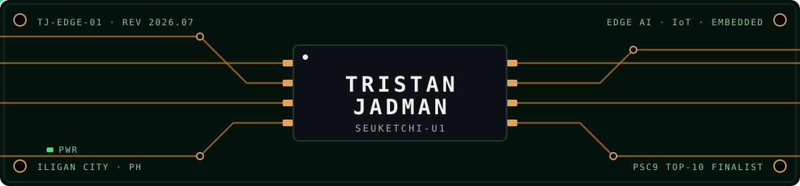

<code>TJ-EDGE-01</code> · datasheet rev 2026.07 · Iligan City, PH
  

## 1 · GENERAL DESCRIPTION

The **SEUKETCHI-U1** is a computer engineering student in a compact, low-power package,
integrating edge AI, embedded systems, and mobile development on a single die. The device
runs reinforcement learning and CNN inference on microcontroller-class hardware, drives
Flutter applications, and has been benchmarked at **Top 10 nationally** (Philippine
Startup Challenge 9).

Current operating mode: **thesis** — reinforcement learning on edge hardware for smart
agriculture (tomato ripening 🍅), with Fresco Greenovation.

## 2 · POWER-ON SELF-TEST — UART0

## 3 · FEATURES

- CNN inference on the MAX78000 neural-accelerator MCU via the ai8x toolchain
- On-device reinforcement learning for agritech telemetry
- Single-cycle MIPS CPU implemented in Verilog on FPGA
- ESP32 + FreeRTOS firmware: NFC access control, PID control loops
- Flutter/Dart mobile development; React/TypeScript on the web side
- Integrated ethical-hacking coprocessor (HackTheBox)

## 4 · PIN CONFIGURATION — PROJECTS

| PIN | NAME | TYPE | FUNCTION |
|:---:|------|:----:|----------|
| 1 | [`edge-rl-tomato-ripening`](https://github.com/Seuketchi/edge-rl-tomato-ripening-data) | `AI/RL` | Thesis — telemetry from hardware runs, reproducibility scripts, timelapse. **Active.** |
| 2 | [`max78000-edge-ai`](https://github.com/Seuketchi/max78000-horse-human-classifier) | `AI/EMB` | CNN image classifiers on a neural-accelerator microcontroller (ai8x-trained) |
| 3 | `zeus-ai` | `AI/PWR` | Smart energy management — pitched at PSC9, *Top 10 nationally* |
| 4 | [`mips-single-cycle-fpga`](https://github.com/Seuketchi/mips-single-cycle-fpga) | `HW` | Single-cycle MIPS processor in Verilog, deployed on FPGA |
| 5 | `nfc-access-control` | `EMB` | ESP32 access control — NFC student ID, LCD, RTOS scheduling |
| 6 | [`ever-ease`](https://github.com/Seuketchi/Ever-ease) | `EMB` | PID-controlled laptop cooling (Feedback & Control Systems) |
| 7 | `NC` | — | Reserved for future projects |

## 5 · SUPPORTED TOOLCHAINS

| DOMAIN | STACK |
|--------|-------|
| Edge AI / ML | `Python` `PyTorch` `ai8x` |
| Embedded | `C` `C++` `Arduino` `ESP32` `MAX78000` `FreeRTOS` |
| Hardware | `Verilog` `FPGA` `MIPS Assembly` |
| Mobile / Web | `Flutter` `Dart` `React` `TypeScript` `Tailwind` |
| Infra / Tools | `Firebase` `Supabase` `Git` `Linux` `Figma` |

## 6 · APPLICATION NOTES — EXPERIENCE

| AN | TITLE | PERIOD |
|:---:|-------|--------|
| AN-003 | Founder & CEO — Dalumat Film Group | 2025 – present |
| AN-002 | Agritech Intern — Fresco Greenovation | 2025 – present |
| AN-001 | Junior Layout & Design Head — Student Publication | 2024 – 2025 |

## 7 · TYPICAL PERFORMANCE CHARACTERISTICS

## 8 · REVISION HISTORY

| REV | DATE | CHANGES |
|:---:|------|---------|
| 2026.07 | Jul 2026 | Edge-RL thesis in progress; MAX78000 classifiers shipped; civic-tech contributions (BetterIligan) |
| 2025 | — | PSC9 Top-10 finalist (Zeus AI); joined Fresco Greenovation; founded Dalumat Film Group |
| 2024 | — | First CPU in Verilog; ESP32/RTOS systems; student publication design head |

---

 
© Seuketchi Semiconductor — specifications subject to change without notice.

