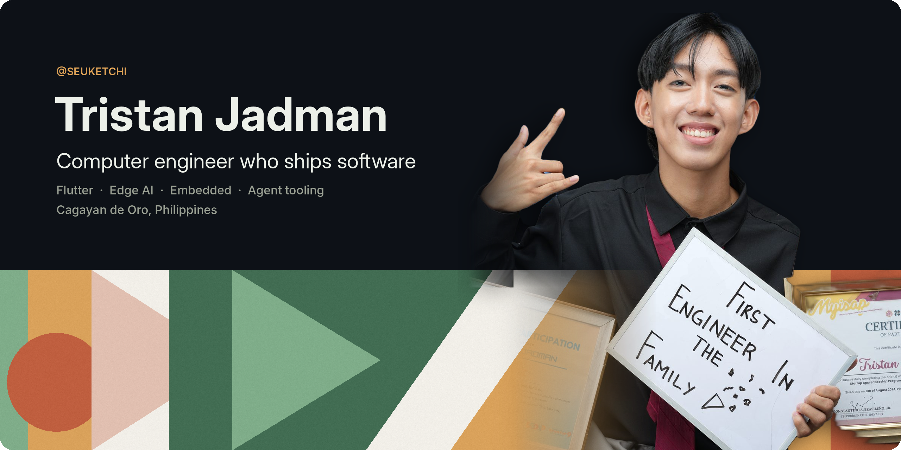

I'm a computer engineering graduate from MSU-IIT who works on both hardware and software. By day I'm a **software developer building Flutter apps in fintech**. Before that I put **reinforcement learning on a $33 microcontroller** for my thesis, and our team pitched **Zeus AI** to a **Top 10 national finish** at the Philippine Startup Challenge 9.

### Selected work

- **[edge-rl-tomato-ripening](https://github.com/Seuketchi/edge-rl-tomato-ripening-data)**: thesis, defended June 2026. A sim-trained RL agent runs on an ESP32-S3 and decides when to ripen tomatoes. This repo has the hardware telemetry, reproducibility scripts and a timelapse.
- **[max78000-edge-ai](https://github.com/Seuketchi/max78000-horse-human-classifier)**: CNN image classifiers running on a microcontroller with a built-in neural accelerator.
- **[mips-single-cycle-fpga](https://github.com/Seuketchi/mips-single-cycle-fpga)**: a single-cycle MIPS CPU written in Verilog and running on an FPGA.
- **[BetterIligan](https://github.com/Seuketchi/BetterIligan)**: volunteer civic tech that makes Iligan City's local government data easy to find.

### Toolbox

`Flutter` `Dart` `Kotlin` `Spring Boot` `React` `TypeScript` · `Python` `PyTorch` `C` `C++` `ESP32` `FreeRTOS` · `Verilog` `FPGA` · `Linux` `Git` `Claude Code`
